# Manually Creating a VPC in AWS

A hands-on lab that builds a VPC with a public and a private subnet, a bastion host and a private server, using the AWS Management Console. It includes every setting, the SSH commands, the tests, and the errors I hit along the way.

**Region:** Europe (Stockholm), `eu-north-1`
**Approach:** Manual setup (the "VPC only" option), which is better for understanding how each piece fits together.

## Contents

- [What you will build](#what-you-will-build)
- [Architecture](#architecture)
- [Prerequisites](#prerequisites)
- [Key concepts](#key-concepts)
- [Steps](#steps)
- [Testing](#testing)
- [Errors encountered and fixes](#errors-encountered-and-fixes)
- [Verification checklist](#verification-checklist)
- [Clean-up](#clean-up)
- [Next steps](#next-steps)

## What you will build

- A custom VPC (`my-first-vpc`) with the CIDR block `10.0.0.0/16`
- A public subnet (`10.0.0.0/24`) with a route to the internet
- A private subnet (`10.0.1.0/24`) with no direct route to the internet
- An Internet Gateway attached to the VPC
- A custom public route table (`my-public-route-table`)
- Two security groups (`bastion-sg` and `private-sg`)
- A bastion host in the public subnet and a private server in the private subnet, reachable only through the bastion

## Architecture

```text
VPC: my-first-vpc (10.0.0.0/16), eu-north-1
|
|-- Internet Gateway (attached to the VPC)
|
|-- public subnet  10.0.0.0/24 (eu-north-1a)
|     route table: my-public-route-table (local + 0.0.0.0/0 -> IGW)
|     bastion: public IP, bastion-sg
|
|-- private subnet 10.0.1.0/24 (eu-north-1a)
      route table: main (local only)
      private-server: 10.0.1.148, no public IP, private-sg
```

| Component | Name | Value |
|---|---|---|
| VPC | my-first-vpc | 10.0.0.0/16 |
| Public subnet | public subnet | 10.0.0.0/24 (eu-north-1a) |
| Private subnet | private subnet | 10.0.1.0/24 (eu-north-1a) |
| Internet Gateway | attached to my-first-vpc | route 0.0.0.0/0 |
| Route table | my-public-route-table | local + 0.0.0.0/0 to IGW |
| Security group | bastion-sg | SSH (22) from My IP |
| Security group | private-sg | SSH (22) from bastion-sg only |
| EC2 instance | bastion | public subnet, public IP, Ubuntu 24.04, t3.micro |
| EC2 instance | private-server | private subnet, no public IP, 10.0.1.148 |

## Prerequisites

- An AWS account with permission to create VPC and EC2 resources
- An SSH client (this lab used a Vagrant VM running Ubuntu)
- Familiarity with basic networking terms such as CIDR blocks and IP addresses

## Key concepts

- **VPC:** An isolated portion of the AWS Cloud where you launch resources such as EC2 instances.
- **CIDR block:** The range of IP addresses for the VPC. A `/16` gives a large address space, and each `/24` subnet provides 256 IPs.
- **Subnet:** A slice of the VPC's address range, placed in one Availability Zone.
- **Internet Gateway (IGW):** Lets traffic flow between the VPC and the internet.
- **Route table:** Rules that decide where network traffic from a subnet is sent.
- **Public vs private subnet:** A subnet is public when its route table has a route to an Internet Gateway. Without that route, it is private.
- **Bastion host:** A server in the public subnet used as the only way in to servers in the private subnet.
- **Security group:** A virtual firewall attached to an instance. A rule can use another security group as its source instead of an IP range.

## Steps

### Step 1: Create the VPC

1. Open the **VPC** console, go to **Your VPCs**, and choose **Create VPC**.
2. Under **Resources to create**, select **VPC only**.
3. Set **Name tag** to `my-first-vpc`.
4. For **IPv4 CIDR block**, choose **IPv4 CIDR manual input** and enter `10.0.0.0/16`.
5. Leave **IPv6 CIDR block** as **No IPv6 CIDR block**, **Tenancy** as **Default**, and **VPC encryption control** as **None**.
6. Choose **Create VPC**.

> AWS automatically creates a **main route table** for the VPC. Remember this for Step 4.

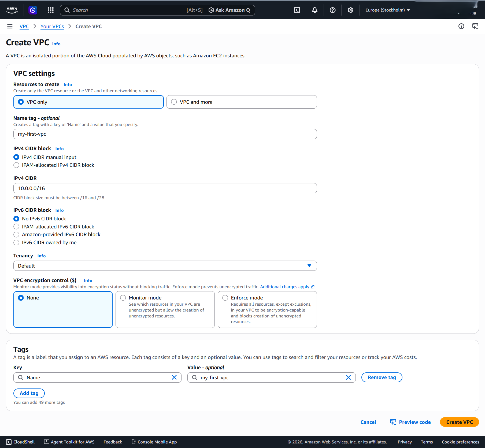

### Step 2: Create the subnets

Go to **Subnets** and choose **Create subnet**. Create two subnets in `my-first-vpc`.

**Public subnet**

| Setting | Value |
|---|---|
| Subnet name | public subnet |
| Availability Zone | Europe (Stockholm) / eun1-az1 (eu-north-1a) |
| IPv4 subnet CIDR block | 10.0.0.0/24 |

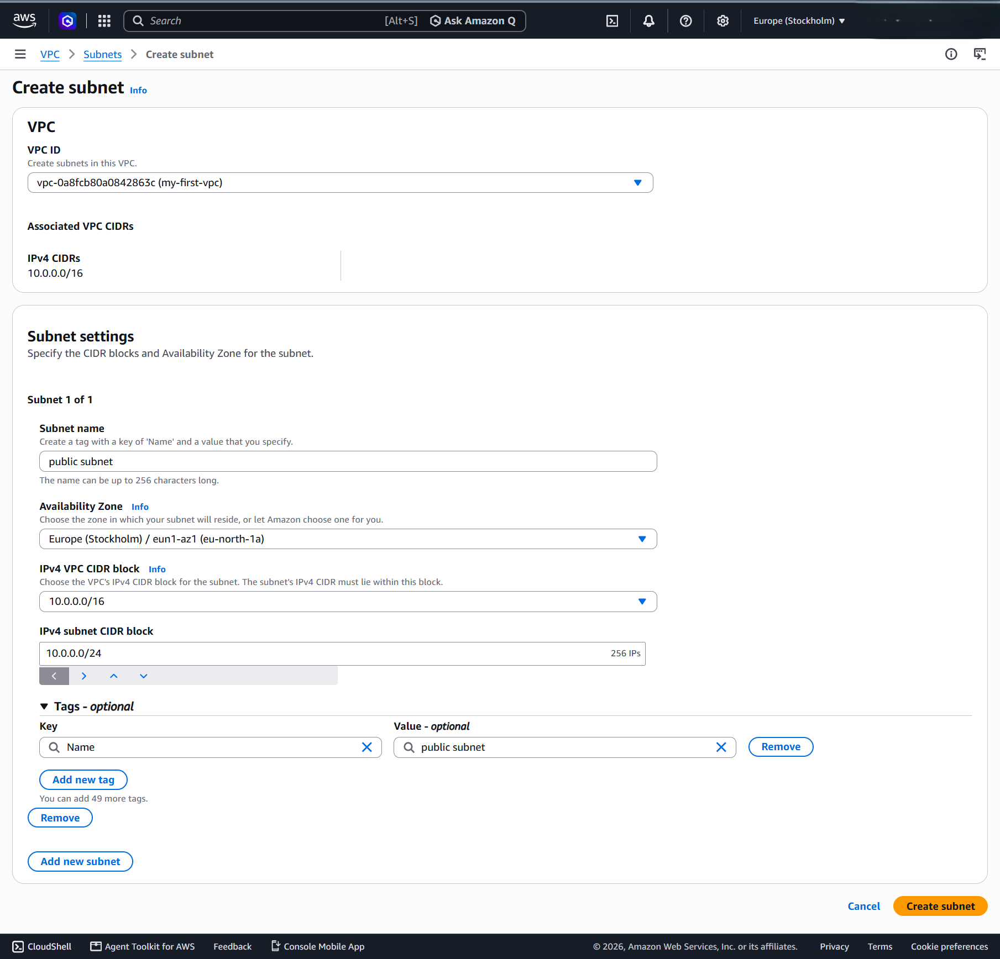

**Private subnet**

| Setting | Value |
|---|---|
| Subnet name | private subnet |
| Availability Zone | Europe (Stockholm) / eun1-az1 (eu-north-1a) |
| IPv4 subnet CIDR block | 10.0.1.0/24 |

Always choose the Availability Zone explicitly (see [Errors](#errors-encountered-and-fixes)).

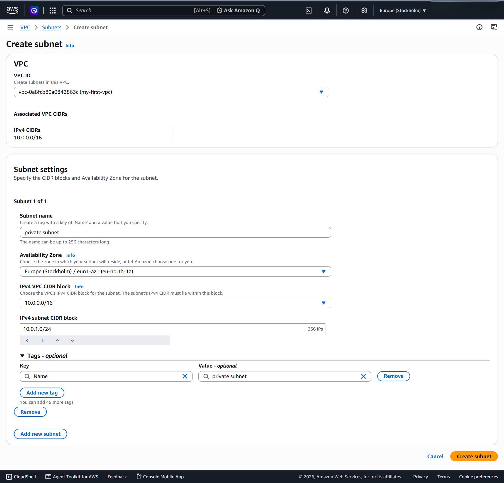

### Step 3: Create and attach an Internet Gateway

1. Go to **Internet gateways** and choose **Create internet gateway**.
2. From **Actions**, choose **Attach to VPC**, select `my-first-vpc`, and choose **Attach internet gateway**.

An Internet Gateway does nothing on its own. It only becomes useful once a route table points to it.

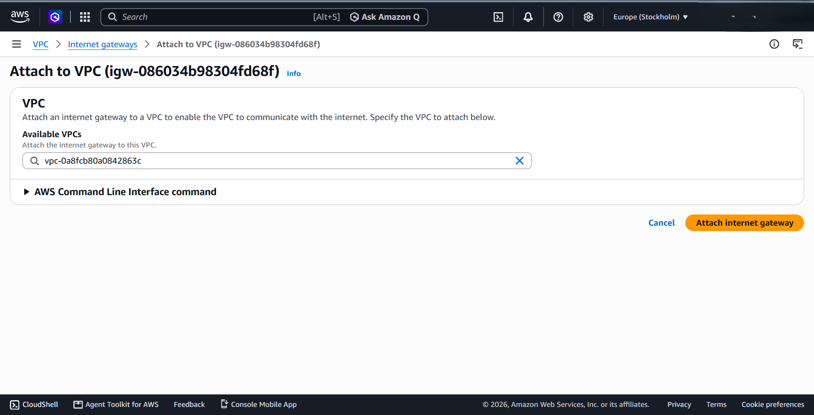

### Step 4: Create a public route table

**Do not add the Internet Gateway route to the main route table.** If you do, every new subnet you create later becomes public automatically, which defeats the purpose of having private subnets.

1. Go to **Route tables** and choose **Create route table**.
2. Name: `my-public-route-table`. VPC: `my-first-vpc`.
3. Open the new table, choose **Edit routes**, then **Add route**: destination `0.0.0.0/0`, target **Internet Gateway** (the one from Step 3).
4. Choose **Save changes**.
5. Open **Subnet associations**, choose **Edit subnet associations**, select only the **public subnet**, and save.

The private subnet stays on the main route table, which only has the local route (`10.0.0.0/16`).

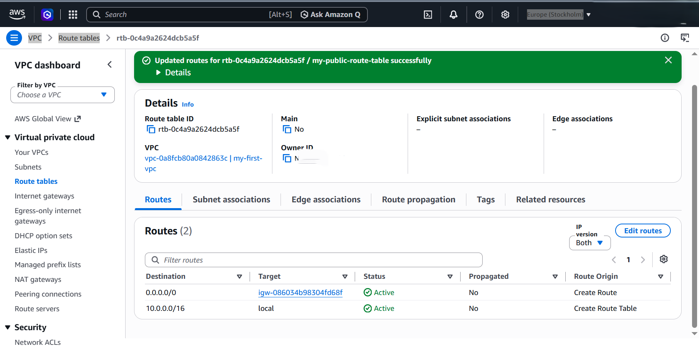

### Step 5: Enable auto-assign public IPv4 on the public subnet

1. Go to **Subnets**, select the **public subnet**, then **Actions** > **Edit subnet settings**.
2. Tick **Enable auto-assign public IPv4 address** and save.

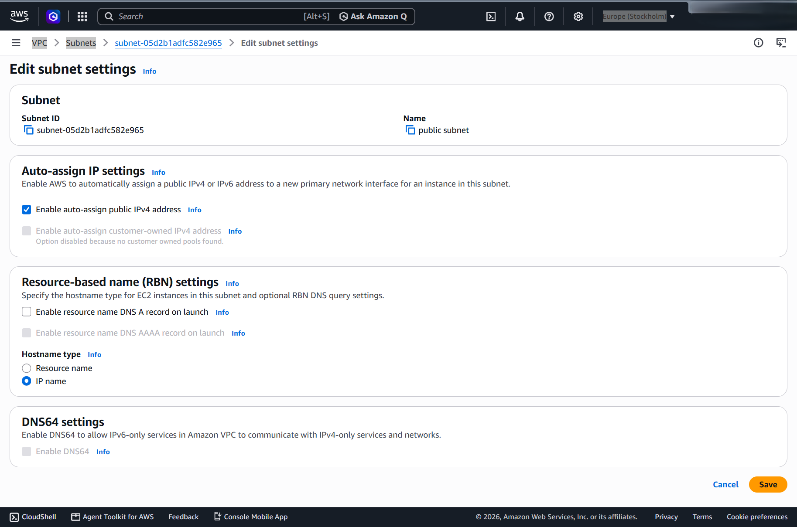

### Step 6: Create the security groups

Every VPC comes with a security group named `default`, so create two new ones. Go to **EC2** > **Security Groups** > **Create security group**.

**bastion-sg**

| Setting | Value |
|---|---|
| Description | allow ssh from My IP |
| VPC | my-first-vpc |
| Inbound rule | SSH (TCP 22), source type **My IP** |
| Outbound rule | All traffic to 0.0.0.0/0 (default) |

**private-sg**

| Setting | Value |
|---|---|
| Description | Allow SSH from the bastion security group only |
| VPC | my-first-vpc |
| Inbound rule | SSH (TCP 22), source type **Custom**, source = `bastion-sg` (type `sg-` and pick it from the list) |
| Outbound rule | All traffic to 0.0.0.0/0 (default) |

Using a security group as the source, instead of an IP range, means only the bastion can SSH into the private server, whatever IP the bastion has.

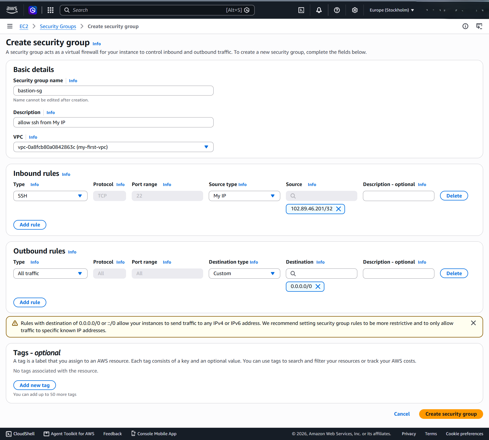
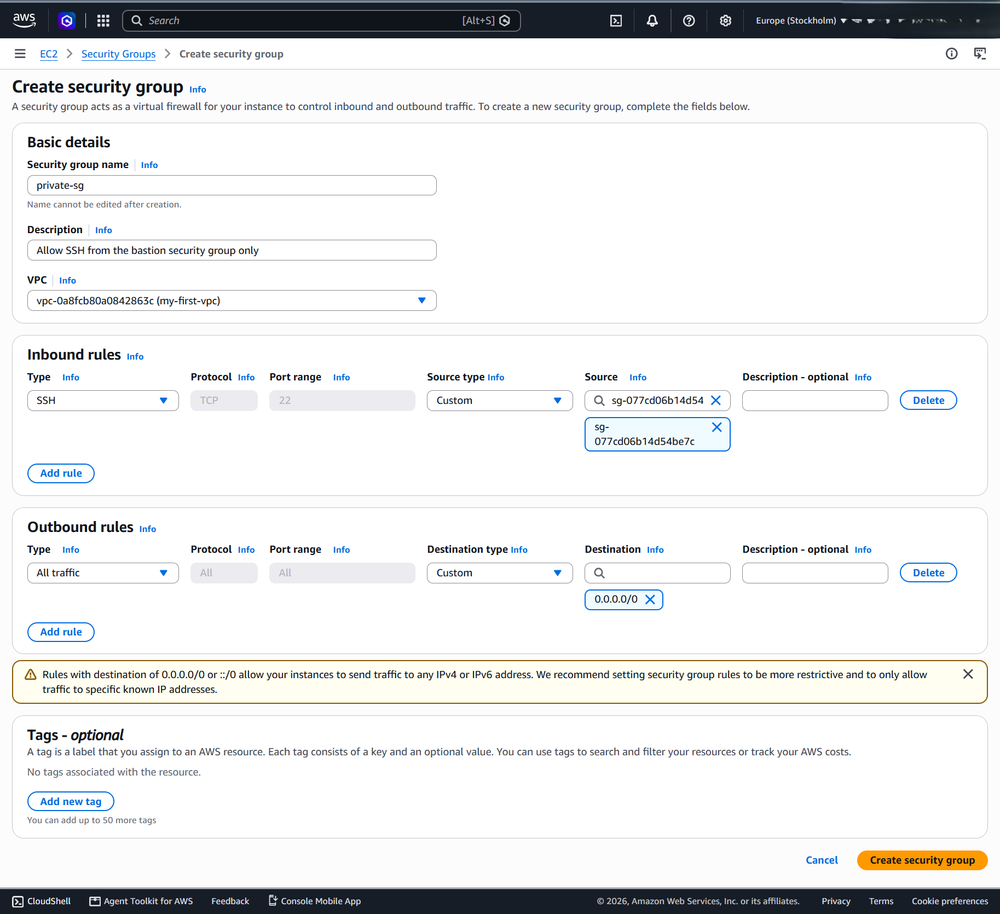

### Step 7: Launch the bastion host

Go to **EC2** > **Launch instance**:

| Setting | Value |
|---|---|
| Name | bastion |
| AMI | Ubuntu Server 24.04 LTS (default username: `ubuntu`) |
| Instance type | t3.micro (free tier eligible) |
| Key pair | Create a new RSA `.pem` key pair named `bastion-kp` and save the file safely |
| VPC | my-first-vpc |
| Subnet | public subnet |
| Auto-assign public IP | Enable |
| Security group | Select existing: `bastion-sg` |

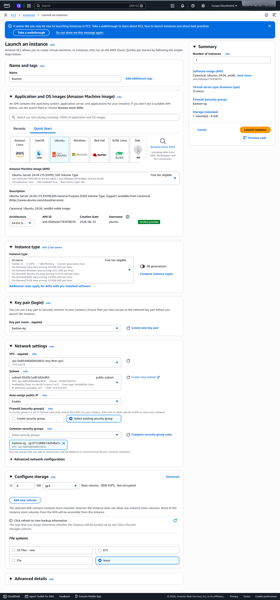

### Step 8: Launch the private server

Launch a second instance with the same AMI, instance type and key pair:

| Setting | Value |
|---|---|
| Name | private-server |
| VPC | my-first-vpc |
| Subnet | private subnet |
| Auto-assign public IP | Disable |
| Security group | Select existing: `private-sg` |

Once it is running, copy its private IPv4 address from the instance details (`10.0.1.148` in this lab).

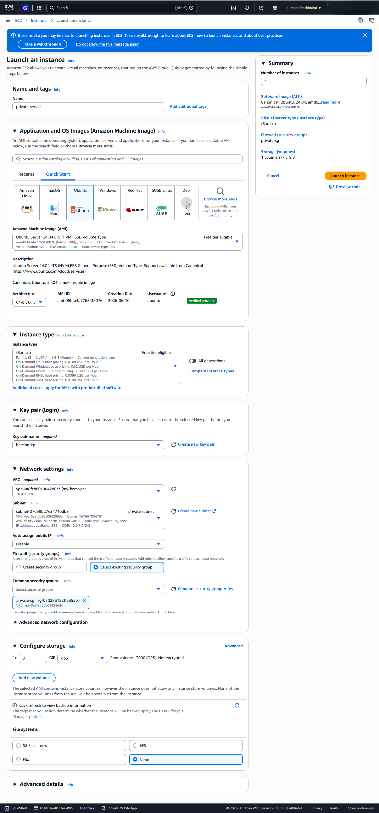

### Step 9: Connect to the private server through the bastion

The private server has no public IP, so you reach it through the bastion. SSH agent forwarding (`-A`) carries your local key through the bastion, so the `.pem` file never needs to be copied onto it.

1. Get the key onto the machine you SSH from. In this lab that was a Vagrant VM: in PowerShell run `cd .\Downloads\` and `Get-Content bastion-kp.pem`, copy the key exactly, run `vagrant ssh`, then create the file with `vi bastion-kp.pem`, paste the key and save.
2. Restrict the file permissions, start the agent and load the key:

   ```bash
   chmod 400 bastion-kp.pem
   eval "$(ssh-agent -s)"
   ssh-add ~/bastion-kp.pem
   ```

3. Connect to the bastion with forwarding, using its **public** IPv4 address:

   ```bash
   ssh -A ubuntu@<bastion-public-ip>
   ```

4. From the bastion, connect to the private server:

   ```bash
   ssh ubuntu@10.0.1.148
   ```

## Testing

### Test 1: The private server has no route to the internet

From inside the private server:

```bash
ping -c 3 8.8.8.8
```

- **Expected:** it fails, because there is no NAT gateway and no route out.
- **Result:** 3 packets transmitted, 0 received, 100% packet loss.

### Test 2: Only the bastion can SSH into the private server

The goal is to confirm that `private-sg` accepts SSH from the bastion's security group and from nothing else.

**Positive check:** from the bastion, `ssh ubuntu@10.0.1.148` logs in successfully.

**Negative check:** a temporary instance, `temporarytest-instance`, launched inside the VPC so the test has a real network path:

| Setting | Value |
|---|---|
| Private IP | 10.0.1.23 |
| Security group | test-client-sg ("Security group for testing SSH access to the private EC2 instance") |
| VPC and subnet | my-first-vpc, private subnet |
| Auto-assign public IP | Disabled |
| Inbound rule | SSH from `bastion-sg`, so the instance can be reached through the bastion |
| Outbound rule | All traffic to 0.0.0.0/0 |

From that instance:

```bash
ssh ubuntu@10.0.1.148
# ssh: connect to host 10.0.1.148 port 22: Connection timed out
```

**Conclusion:** the test instance has a network path to the private server but a different security group, and its connection timed out, while the bastion got in. This shows that `private-sg` allows SSH from the bastion's security group only. A security group drops disallowed traffic silently, which is why the failure shows as a timeout.

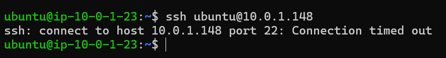

## Errors encountered and fixes

### Error 1: No Availability Zone chosen for the subnets

- **What happened:** I did not choose an AZ when creating the public and private subnets.
- **Fix:** Place both subnets explicitly in `eu-north-1a`.

### Error 2: Internet Gateway route added to the main route table

- **What happened:** I added `0.0.0.0/0` to the main route table AWS created for the VPC. Every subnet, including the one meant to be private, became public.
- **Fix:** Create a custom route table (`my-public-route-table`), add the Internet Gateway route there only, and associate only the public subnet with it.

### Error 3: Used the private IP to SSH into the bastion

- **What happened:** From my Vagrant VM I tried the private IPv4 addresses (`10.0.0.166` and `10.0.1.148`), and both returned `Connection refused`.
- **Fix:** Use the bastion's **public** IPv4 address. Private IPs are only reachable from inside the VPC.

### Error 4: SSH from the bastion to the private server failed

- **What happened:** From the bastion, `ssh ubuntu@10.0.1.148` returned `Permission denied (publickey)`, and `ssh-add -l` could not open a connection to the authentication agent. The `.pem` file lives on my Vagrant machine, not on the bastion, so `-i ~/bastion-kp.pem` cannot work from there.
- **Fix:** Exit, start the agent with `eval "$(ssh-agent -s)"`, run `ssh-add ~/bastion-kp.pem`, then connect with `ssh -A ubuntu@<bastion-public-ip>`. Then run `ssh ubuntu@10.0.1.148`.

### Error 5: Testing from the Vagrant VM proved nothing

- **What happened:** SSH from my Vagrant VM to `10.0.1.148` returned `Connection refused`. That does not prove the security group works, because the VM has no network path to a private AWS IP.
- **Fix:** Launch a temporary instance inside the VPC (`temporarytest-instance` with `test-client-sg`) so the test travels a real network path. See [Test 2](#test-2-only-the-bastion-can-ssh-into-the-private-server).

## Verification checklist

- [ ] VPC `my-first-vpc` exists with CIDR `10.0.0.0/16`
- [ ] Both subnets exist inside the VPC, with the correct CIDRs
- [ ] The Internet Gateway shows state **Attached** to `my-first-vpc`
- [ ] `my-public-route-table` has two routes: `10.0.0.0/16` to local and `0.0.0.0/0` to the IGW
- [ ] Only the public subnet is associated with `my-public-route-table`
- [ ] The private subnet still uses the main route table (local route only)
- [ ] Auto-assign public IPv4 is enabled on the public subnet only
- [ ] `bastion-sg` allows SSH only from my IP, and `private-sg` allows SSH only from `bastion-sg`
- [ ] The bastion has a public IP and the private server has none
- [ ] SSH from my machine to the private server works through the bastion
- [ ] `ping 8.8.8.8` from the private server fails
- [ ] SSH to the private server from an instance outside `bastion-sg` times out

## Clean-up

To avoid unexpected charges, delete resources in this order:

1. Terminate the three EC2 instances (`bastion`, `private-server`, `temporarytest-instance`) and any NAT gateways.
2. Delete the security groups: `private-sg` and `test-client-sg` first (they reference `bastion-sg`), then `bastion-sg`.
3. Detach and delete the Internet Gateway.
4. Delete the subnets, then the custom route table, then the VPC.
5. Optionally delete the `bastion-kp` key pair from EC2 and remove the local `.pem` file.

A VPC, subnets, route tables and an Internet Gateway are free, but NAT gateways and public IPv4 addresses are billed.

## Next steps

- Add a **NAT Gateway** in the public subnet and route the private subnet through it, then re-run the ping test. It should now succeed outbound while the server stays unreachable inbound.
- Add a second Availability Zone with another public/private pair for resilience.
- Compare **security groups with NACLs** and practice using both.

## Repository layout

```text
.
|-- README.md
|-- images/        # screenshots referenced above
```
